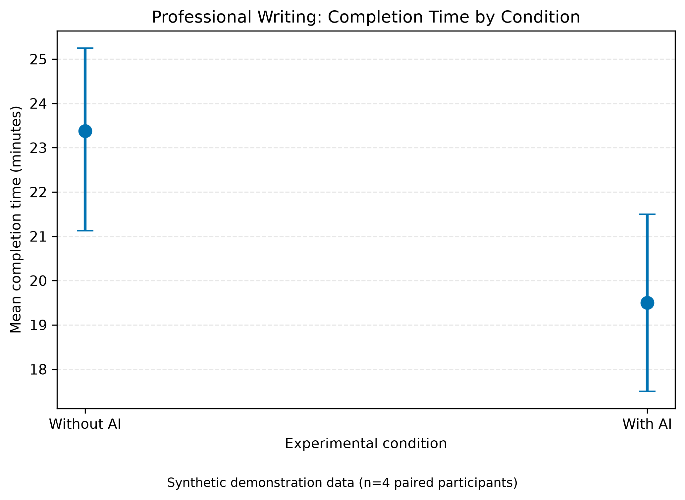
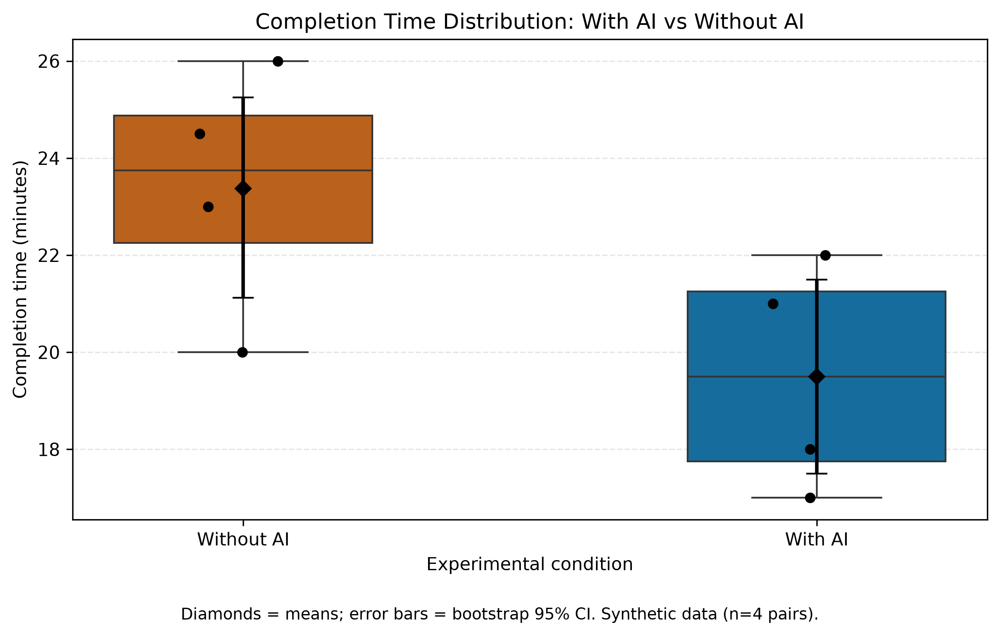
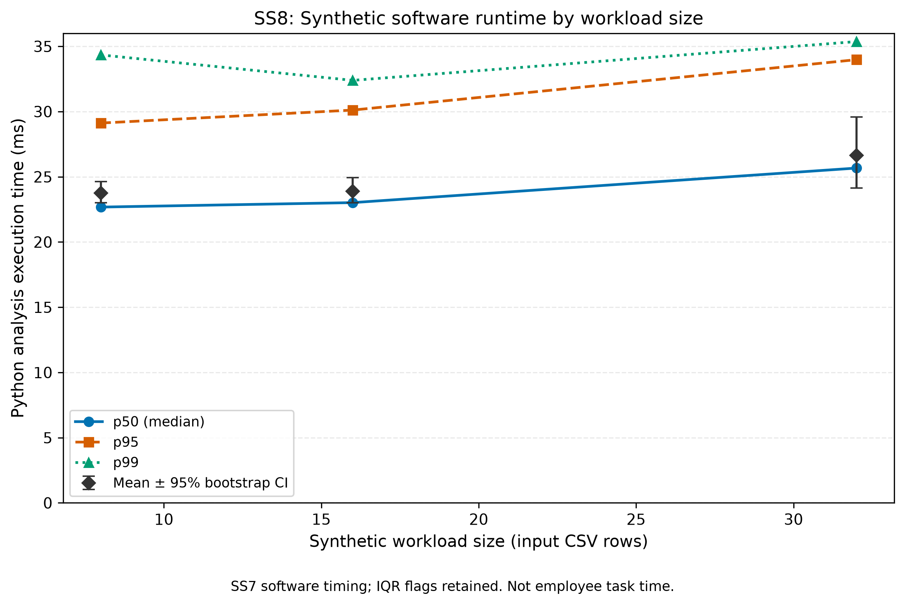
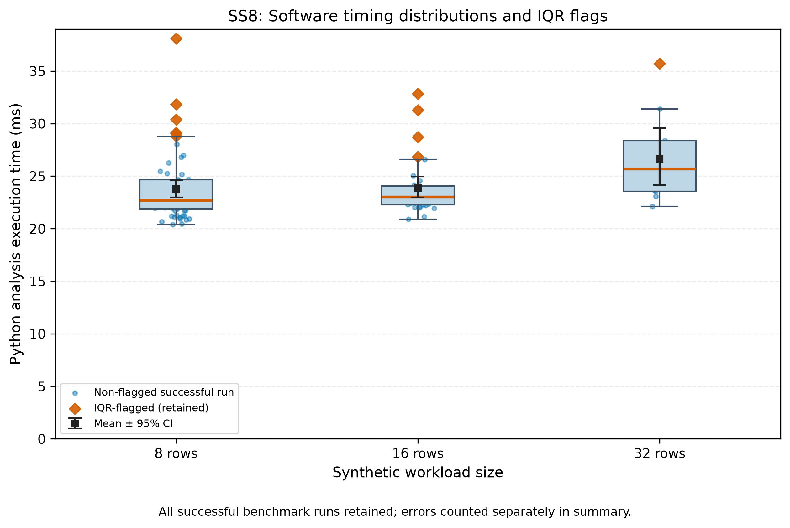

# Generative AI and Knowledge-Worker Productivity


**Full study title:** The Impact of Generative AI Tools on Employee Productivity and Work Quality in Knowledge-Based Office Tasks
**Institution:** Narxoz University
**Team:** Muratbek Ramazan and Tasbolatkyzy Zhanerke
**Project type:** Research-methods course project; experimental proposal, data-analysis demonstration and reproducible research pipeline.
**Research status as of 5 November 2026:** **No human participants have been recruited or tested. All published example measurements are synthetic. The repository does not demonstrate that GenAI improves productivity.**

## 1. Aim and research questions

The proposed study asks whether access to Generative AI changes the **time needed by knowledge workers to complete matched professional writing tasks**, without unacceptably lowering writing quality or factual correctness.

- **RQ2 (primary):** Does optional GenAI assistance reduce time to complete comparable professional writing tasks? Primary outcome: **human task-completion time in minutes**.
- **Secondary outcomes:** rubric-based writing quality (0–100), anchor-fact correctness/recall, and exploratory factual Precision and F1.
- **RQ3 (exploratory):** How might outcomes vary with relevant professional experience? The current synthetic sample does not establish subgroup effects.
- **RQ1 (separate descriptive component):** How is GenAI integrated into daily workflows? The crossover experiment alone cannot answer this question.

**Design:** A proposed randomized, counterbalanced, within-participant crossover. Each future consenting participant performs matched task sets A and B, one **with AI** and one **without AI**, with condition order and task-set assignment balanced. The fair baseline is a human writer using standard editing tools and the same reference material **without AI**; neither a Python function nor an LLM API call is the control group. The provisional task cap is 30 minutes. See [`docs/protocol.md`](docs/protocol.md), [`docs/task_sets.md`](docs/task_sets.md), and [`docs/evaluation_rubric.md`](docs/evaluation_rubric.md).

## 2. Distinguish the two independent synthetic data streams

| Stream | Source | Unit / sample | Meaning |
|---|---|---|---|
| **Proposed human-writing crossover (illustration)** | [`data/sample/example_measurements.csv`](data/sample/example_measurements.csv) | **minutes**; 8 synthetic records, **4 fictional paired participants** | Illustrates the paired analysis of **with-AI vs without-AI human tasks**. No real workers were measured. |
| **SS7–SS8 engineering benchmark (illustration)** | [`data/sample/ss7_software_benchmark_demo.jsonl`](data/sample/ss7_software_benchmark_demo.jsonl) | **milliseconds**; 1 metadata event, 5 warm-ups and 100 measured runs | Times the project's **Python validation/analysis code** using synthetic workload sizes. It does **not** measure AI inference, request throughput or employee productivity. |

**Never pool these streams, equate 100 software runs with 100 people, or interpret machine-runtime differences as an effect of AI on workers.** The published SS7 example was collected in a development environment; local Windows timings differ by hardware/OS and Python version.

The `data/raw/` directory is intentionally ignored by Git to prevent accidental disclosure of future participant information. A safe reproducible **synthetic** JSONL example is committed under `data/sample/`. You can regenerate a local `data/raw/test_run.jsonl` with the SS7 collector.

## 3. Demonstration results — NOT empirical research findings

### Synthetic writing-task example

Each condition has **n = 4 fictional observations**, representing the same **4 fictional people** across matched tasks:

| Metric | Without AI | With AI |
|---|---:|---:|
| Mean completion time, minutes | 23.375 | 19.500 |
| Median completion time, minutes | 23.750 | 19.500 |
| SD completion time, minutes | 2.562 | 2.380 |
| p95 completion time, minutes | 25.775 | 21.850 |
| Mean rubric quality, points / 100 | 81.625 | 84.500 |
| Mean anchor-fact accuracy / recall, % | 85.000 | 95.000 |
| Mean unsupported-claim rate, % | 9.167 | 15.714 |

For participant *i*, let `D_i = T_without_ai,i - T_with_ai,i` in **minutes**. The sample **mean paired time saved** is **3.875 minutes**, with **95% percentile bootstrap CI [0.00, 6.25] minutes**, 10,000 participant-level resamples, random seed 42. **The interval includes zero.** These numbers are a program demonstration, not evidence of actual productivity improvement.

Mean quality difference (with minus without AI) is **+2.875 points**. The Boolean `quality_guardrail_passed` in the saved synthetic summary means **only** that this illustrative point estimate lies above the provisional -5-point margin. It **does not establish statistical non-inferiority**; that would require a suitably justified margin and a lower confidence bound above -5 on real participant data.

### Synthetic software-execution benchmark

After excluding **5 warm-ups**, the committed public JSONL sample contains **100 measured runs**, all successful (0% failure rate); **11 IQR outlier flags** were retained, not deleted. Overall successful-run mean **24.058 ms**, SD **3.303 ms**, median **22.938 ms**, p95 **31.273 ms**, p99 **35.736 ms**. The percentile-bootstrap 95% CI for the **mean software duration** is **[23.422, 24.749] ms**. Runs from one machine need not be independent, so this CI is descriptive. Figures and full workload-group summaries are in [`docs/SS8_DATA_PROCESSING.md`](docs/SS8_DATA_PROCESSING.md) and [`data/processed/ss8_software_metrics_summary.csv`](data/processed/ss8_software_metrics_summary.csv).

## 4. Scientific figures and notebooks

**Human-writing demonstration (minutes)** — original Task 3 visualizations contributed by the team:





The filenames `fig1_latency_vs_load` and `fig2_distribution_boxplot` are historical. **The first figure is NOT latency-versus-load**; it shows synthetic **human completion time by AI condition**. Both figures are available as high-resolution PNG and vector PDF.

**SS8 technical benchmark (milliseconds)** — separate figures for the Python analysis pipeline:





The two executed demonstration notebooks are [`notebooks/01_data_analysis.ipynb`](notebooks/01_data_analysis.ipynb) (human-writing synthetic illustration) and [`notebooks/02_ss8_software_log_analysis.ipynb`](notebooks/02_ss8_software_log_analysis.ipynb) (engineering JSONL). A prior optional notebook exists at [`notebooks/analysis.ipynb`](notebooks/analysis.ipynb). Refer to [`docs/domain_model.md`](docs/domain_model.md) for estimands, formulas and design constraints.

## 5. Project map — SS5 to SS10

| Course component | Primary artifacts |
|---|---|
| **SS5: Experimental design** | `docs/protocol.md`, `docs/task_sets.md`, `docs/evaluation_rubric.md`, `configs/experiment.yaml` |
| **SS6: Reproducibility** | `src/analyze.py`, `src/metrics.py`, `src/validate_data.py`, `src/randomize.py`, `tests/test_metrics.py`, `Dockerfile`, `.github/workflows/tests.yml` |
| **SS7: Measurement logging** | `src/collector.py`, `configs/collector.yaml`, `docs/SS7_MEASUREMENT_LOGGING.md`, synthetic sample JSONL |
| **SS8: Processing and figures** | `src/process_ss7_logs.py`, `src/visualize_ss7_logs.py`, `data/processed/ss8_software_metrics_summary.csv`, `notebooks/02_ss8_software_log_analysis.ipynb`, `reports/figures/ss8_*` |
| **Task 3 original analysis** | `src/process_data.py`, `src/visualize.py`, `data/processed/metrics_summary.csv`, `notebooks/01_data_analysis.ipynb`, `docs/domain_model.md`, `reports/figures/fig1_*` and `fig2_*` |
| **SS9: Scientific reporting** | `reports/paper_section_4.md`, `reports/ss9_equations.tex`, `reports/ss9_tables.tex`, `src/generate_ss9_report.py`, `docs/SS9_SCIENTIFIC_REPORTING.md` |
| **SS10: Overleaf and IMRaD** | `overleaf/main.tex`, `overleaf/sections/*.tex`, `overleaf/references.bib`, `overleaf/README.md`, `docs/SS10_OVERLEAF.md` |
| **Final audit and submission** | `docs/FINAL_AUDIT_AND_CANVAS_SUBMISSION.md`, `docs/CANVAS_SUBMISSION_GUIDE_RU.md` |

## 6. Reproduce everything

**Requirements:** Python **3.11**, pip, a CPU-based computer, and optional Docker Desktop or JupyterLab. No paid GenAI subscription, OpenAI API token or GPU is needed to run the *analysis software*. The hypothetical experimental AI intervention would occur separately during a future consenting human study.

**PowerShell (Windows), from repository root:**

```powershell
.\.venv\Scripts\python.exe -m pip install -r requirements.txt
.\.venv\Scripts\python.exe -m unittest discover -s tests -v
.\.venv\Scripts\python.exe src\validate_data.py data\sample\example_measurements.csv
.\.venv\Scripts\python.exe src\analyze.py --input data\sample\example_measurements.csv --output-dir outputs\demo
.\.venv\Scripts\python.exe src\process_data.py
.\.venv\Scripts\python.exe src\visualize.py
.\.venv\Scripts\python.exe src\collector.py --config configs\collector.yaml
.\.venv\Scripts\python.exe src\process_ss7_logs.py --input data\sample\ss7_software_benchmark_demo.jsonl
.\.venv\Scripts\python.exe src\visualize_ss7_logs.py
.\.venv\Scripts\python.exe src\generate_ss9_report.py --check
```

For a new Python 3.11 environment, first create `.venv` with `py -3.11 -m venv .venv`. The `outputs/` and `data/raw/` directories are local and ignored by Git. **Never** commit actual participant data, tokens, private files or confidential source documents. The SS8 default command writes a processed CSV derived from the public sample; verify intentional changes before committing.

**Docker:** `docker build -t genai-writing-study .` followed by `docker run --rm genai-writing-study`. The Docker default runs the SS6 synthetic human-data analysis, not a human experiment; it does not automatically render all figures or compile LaTeX.

**Notebook:** launch `jupyter lab` inside the environment, open each notebook, select **Restart Kernel and Run All**, and verify regenerated figures and output. The notebooks stored in the repo retain demonstration outputs for inspection.

**Overleaf:** in Overleaf select **New Project → Existing project (.zip)** and upload the contents of the `overleaf/` folder as a zip with `main.tex` at the root. Use pdfLaTeX (IEEEtran) and Recompile. The PDF is an **academic-writing / layout demonstration**, not a published paper or evidence of real experiments.

## 7. Verification, audit and limitations

- The user ran **44/44 local unit tests** on Windows after SS10; the current `main` GitHub Actions check for commit `c8ffe661` completed **successfully**: [CI run](https://github.com/ramazanmuratbek-a11y/genai-productivity-benchmark/actions/runs/42051627235).
- A Docker image was built and executed for an earlier SS6 demonstration; **this does not assert that the entire 44-test suite has been rerun in Docker**.
- Each synthetic dataset is explicitly tagged and used only to demonstrate reproducibility. The two streams differ in units, population, outcome, and causal interpretation.
- A 4-pair bootstrap interval is highly unstable, as are n=4 p95/p99 values. No participant recruitment, informed consent, blinding validation, task-equivalence pilot, formal power analysis or empirical non-inferiority test has yet occurred.
- The SS7 software benchmark is not an HTTP service: no real HTTP status codes or requests-per-second axis exists. In the technical plots, the x-axis is the synthetic workload's input-row count.
- This project has no scientifically justified estimate of GenAI's real-world impact. Future human data must be collected only with consent, approved controls and privacy safeguards.
- See [final audit and submission guide](docs/FINAL_AUDIT_AND_CANVAS_SUBMISSION.md). A course rubric may require a raw log path and a tagged final release; where privacy policy differs, show the local raw file, publish only safe synthetic samples and clarify expectations with the instructor.

## 8. Team, citation and license

**Muratbek Ramazan** — experimental methodology, SS6 reproducible analysis and SS7–SS10 infrastructure/reporting integration.
**Tasbolatkyzy Zhanerke** — evaluation and factual-metric work, original Task 3 `src/process_data.py` / `src/visualize.py`, domain model, notebook and scientific figures.
Contributions are also recorded in the [merged pull requests](https://github.com/ramazanmuratbek-a11y/genai-productivity-benchmark/pulls?q=is%3Apr+is%3Amerged).

```bibtex
@misc{muratbek_tasbolatkyzy_2026_genai_productivity,
  author = {Muratbek, Ramazan and Tasbolatkyzy, Zhanerke},
  title = {The Impact of Generative AI Tools on Employee Productivity and Work Quality in Knowledge-Based Office Tasks},
  year = {2026},
  howpublished = {GitHub repository},
  url = {https://github.com/ramazanmuratbek-a11y/genai-productivity-benchmark}
}
```

Source code is under the [MIT License](LICENSE); this license does not override participant consent or third-party data rights.
