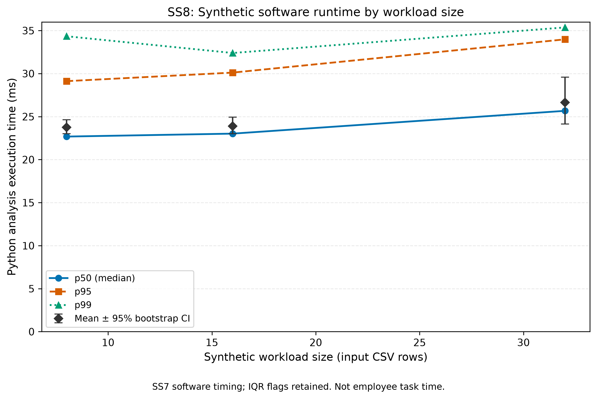
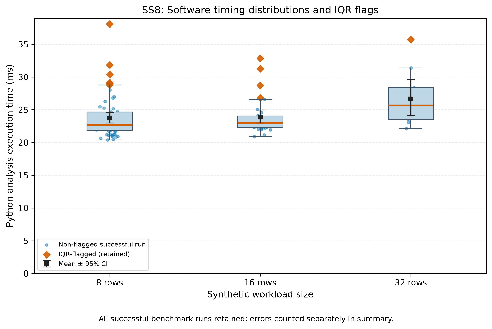

# SS8 — Data Processing and Scientific Visualization (SS7 integration)

**Project:** The Impact of Generative AI Tools on Employee Productivity and Work Quality in Knowledge-Based Office Tasks

**Status:** Demonstration / engineering reproducibility only — **no real participants or empirical productivity results.**

## Important separation of units and estimands

There are two different data streams in this repository:

1. **Human experiment (proposed):** `data/sample/example_measurements.csv`, task completion time in **minutes**, matched AI vs no-AI pairs. The team's existing `src/process_data.py`, `src/visualize.py`, `notebooks/01_data_analysis.ipynb`, and `reports/figures/fig1_...` / `fig2_...` remain **unchanged**.
2. **Technical SS7 lab:** `data/sample/ss7_software_benchmark_demo.jsonl`, software runtime of Task 2's Python pipeline in **milliseconds** under synthetic workload sizes 8/16/32 rows. It does *not* measure worker productivity or API speed. The new SS8 components process this stream separately.

Do **not** combine these two measurement types, derive a human AI productivity effect from SS7 timings, or call the workload size “requests per second” (RPS). This benchmark has no RPS parameter.

## Crosswalk to SS8 instructions

| Lab requirement | Verified implementation |
|---|---|
| JSONL ingestion and schema checks | `src/process_ss7_logs.py`: parse events, validate phase/status/units, timestamp, indices, origin |
| Warm-up filtering | Exclude `phase=warmup` from all benchmark statistics; audit retains counts |
| Failures / selection bias | Include all `benchmark` records in the failure-rate denominator; compute timing quantiles among successful runs only |
| Outliers | Within-profile IQR (`Q1 - 1.5×IQR`, `Q3 + 1.5×IQR`), flag but do not automatically remove |
| Descriptive statistics | Mean, SD, median, p25/p75, p95/p99 separately per workload and overall |
| 95% confidence intervals | 10,000 deterministic percentile-bootstrap resamples of the mean of successful software timings; seed 42 |
| Cleaned CSV and aggregate | `outputs/ss8/clean_software_measurements.csv` and `data/processed/ss8_software_metrics_summary.csv` |
| Two accessible scientific plots | Percentiles vs synthetic input rows; box/distribution + IQR flags; colorblind-safe colors and point markers |
| High-quality export | `reports/figures/ss8_software_{percentiles,distribution}.{png,pdf}` (PNG 300 DPI; vector PDF) |
| Notebook | `notebooks/02_ss8_software_log_analysis.ipynb` with saved execution outputs |
| Tests and CI | `tests/test_ss8_software_logs.py` and automated SS8 smoke step |

**Difference from the generic course handout:** The handout's latency-vs-RPS and HTTP 429/500/504 examples describe an HTTP service, but this project's existing technical collector calls Python functions and never makes HTTP requests. Consequently the x-axis is **synthetic input CSV row count**, and failures are Python exceptions. These choices preserve experimental honesty rather than inventing network traffic and errors.

## How to reproduce (PowerShell, from repository root)

Run in a separate branch after updating `main`:

```powershell
.\.venv\Scripts\python.exe -m unittest discover -s tests -v

# Reproducible public SS7 sample (same data source on every machine):
.\.venv\Scripts\python.exe src\process_ss7_logs.py --input data\sample\ss7_software_benchmark_demo.jsonl
.\.venv\Scripts\python.exe src\visualize_ss7_logs.py

# Optional: use your own SS7 run, but write machine-specific outputs outside Git:
.\.venv\Scripts\python.exe src\process_ss7_logs.py --input data\raw\test_run.jsonl --output outputs\ss8\my_machine_summary.csv --detail outputs\ss8\my_machine_detail.csv --audit outputs\ss8\my_machine_audit.json
```

To inspect a new notebook run: launch `jupyter lab`, open `notebooks/02_ss8_software_log_analysis.ipynb`, and choose **Restart Kernel and Run All**. The committed notebook retains executed output for reviewers.

### Sample demonstration interpretation (NOT scientific findings)

The **published SS7 sample** (recorded in a development Linux environment, not on the student's Windows computer) contains **106 JSONL events**: 1 metadata, 5 warmups and 100 benchmark records. For this sample:

- 100 benchmark runs were recorded, 100 succeeded and 0 failed.
- Mean successful software runtime is around **24.06 ms**; median ~**22.94 ms**; p95 ~**31.27 ms**; p99 ~**35.74 ms**.
- Eleven timing points were flagged with the per-workload IQR heuristic. They were **not deleted**.
- 95% bootstrap confidence intervals are calculated on runs, not on independent human participants. Repeated timings on one machine are not necessarily independent.
- A local run on another OS or Python version **will produce different durations**. The user's separate Windows run had mean **21.19 ms** and p95 **26.22 ms**, which is not a contradiction.

These are diagnostic timings for Python analysis, not causal effects of GenAI on workplace performance. Synthetic data are not a substitute for recruiting participants.

## Outputs and captions

**Figure A — Runtime percentiles by synthetic workload size.** The x-axis shows the input row count (8, 16, 32), the y-axis shows Python analysis runtime (ms). p50/p95/p99 are computed among successful benchmark runs; black diamonds with bars show the estimated mean and its 95% percentile-bootstrap CI. There are **no human AI vs no-AI conditions** in this figure.



**Figure B — Software runtime distributions.** Boxplots show successful-run durations across synthetic workload sizes; orange diamonds mark non-destructively flagged IQR outliers; black squares show mean bootstrap 95% CI. Errors are reported separately and must not be silently omitted from performance summaries.



## Known limitations / audit

- No HTTP traffic is generated, so there are no genuine HTTP error codes or throughput/RPS calculations.
- 100 iterations in this lab are **software runs**, not 100 participants.
- The bootstrap CI is descriptive and assumes sufficiently representative timed runs; machine-specific correlation can invalidate naive uncertainty claims.
- IQR flags are not proof of hardware noise; do not remove them without a predeclared reason.
- Warmup filtering is appropriate to software execution; never discard the first task performed by a human participant as “warmup” in the crossover experiment.
- Public sample log is synthetic and carries no real participant identities.

For the course **Task 3** rubric, this extends the existing reproducible analysis. The main human-writing results and notebook remain proposals/demonstrations and still require real data for empirical conclusions.
