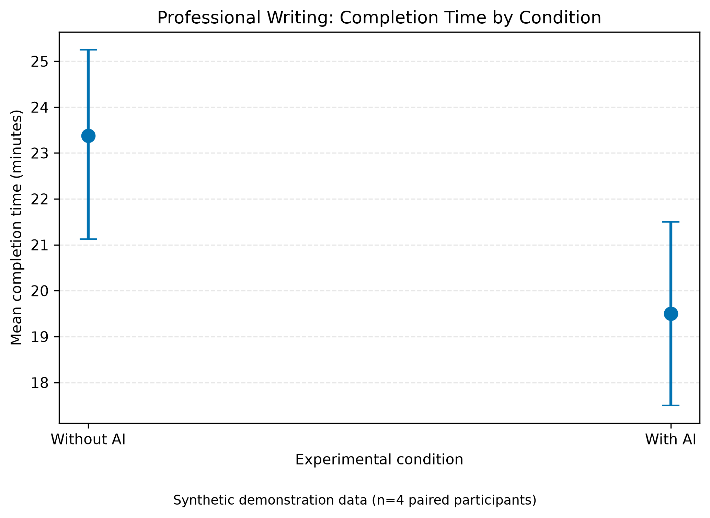
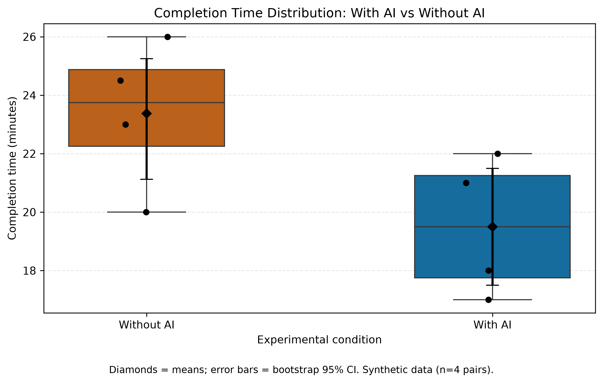
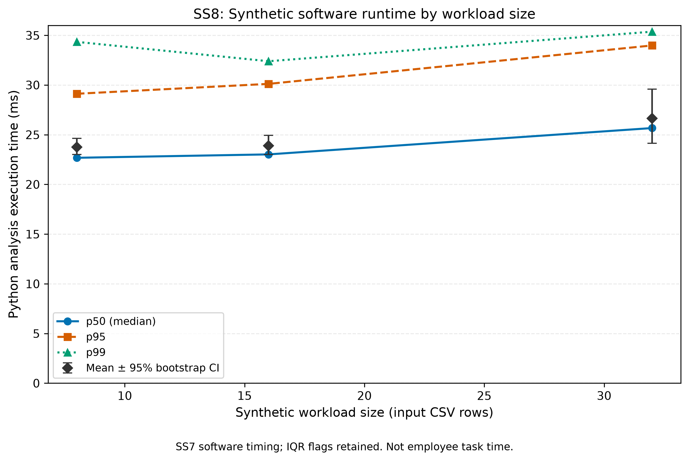
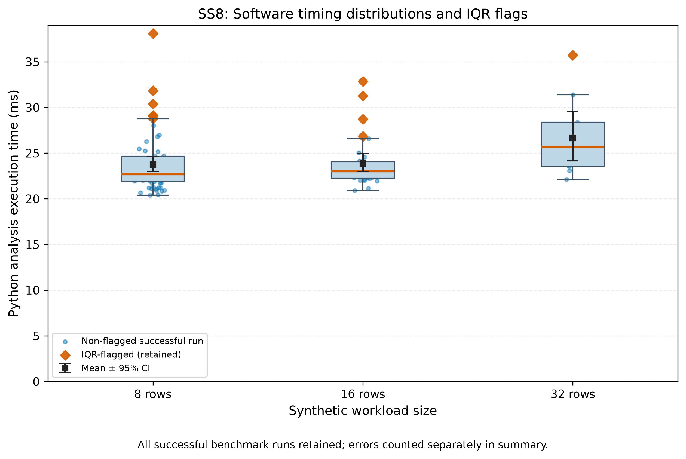

# 4. Experimental Results & Discussion — Synthetic Demonstration Only

**Project:** The Impact of Generative AI Tools on Employee Productivity and Work Quality in Knowledge-Based Office Tasks
**Authors:** Muratbek Ramazan and Tasbolatkyzy Zhanerke · Narxoz University
**Status:** SOFTWARE/ANALYSIS DEMONSTRATION — **NO RECRUITED PARTICIPANTS OR EMPIRICAL AI-PRODUCTIVITY RESULTS.**

## 4.1 Research status and data provenance

The proposed scientific study is a randomized counterbalanced crossover of professional-writing tasks with AI versus without AI. The primary outcome is **human task completion time in minutes**. The supplied `data/sample/example_measurements.csv` contains **4 fictional paired participants** (8 synthetic task records). It illustrates the analysis, not observations of workers. The companion SS7/SS8 material measures *execution of the Python validation-and-analysis pipeline* on generated test workloads in **milliseconds**. It is not AI response latency, human writing speed, or another experimental condition. These two data streams must never be pooled.

Data inputs: [`data/processed/metrics_summary.csv`](../data/processed/metrics_summary.csv) and [`data/processed/ss8_software_metrics_summary.csv`](../data/processed/ss8_software_metrics_summary.csv). The human analysis scripts were prepared by the research team; the SS7/SS8 technical instrumentation is a separately documented extension. See [`docs/domain_model.md`](../docs/domain_model.md) and [`docs/SS8_DATA_PROCESSING.md`](../docs/SS8_DATA_PROCESSING.md).

## 4.2 Formal notation and estimands

Let $n$ be the number of paired participant records, $T_{i,0}$ the without-AI completion time in **minutes**, and $T_{i,1}$ the with-AI time in **minutes**. Let $Q_{i,0}$ and $Q_{i,1}$ denote corresponding quality scores on a 0–100 scale.

$$
D_i = T_{i,0} - T_{i,1}, \qquad
\overline{D} = \frac{1}{n}\sum_{i=1}^n D_i.
$$

Positive $D_i$ indicates time saved. The descriptive speedup ratio and relative reduction are

$$
S = \frac{\overline{T}_0}{\overline{T}_1}, \qquad
R_T = 100\left(1-\frac{\overline{T}_1}{\overline{T}_0}\right)\%.
$$

The $q$th percentile $p_q$ is the empirical quantile at cumulative probability $q/100$. For a percentile-bootstrap confidence interval on a **mean**, draw $B=10{,}000$ samples of the relevant observation unit with replacement using seed 42, recompute the mean, and take its 2.5th and 97.5th percentiles. For the paired human demonstration, the resampling unit is the participant-level **paired difference** $D_i$; for the software illustration, it is a successful benchmark run. These two uncertainty calculations have different meanings and assumptions.

| Symbol | Meaning | Units |
|:--|:--|:--|
| $n$ | Number of fictional paired participants | pairs |
| $T_{i,0}, T_{i,1}$ | Writing duration without / with AI | minutes |
| $D_i$ | Paired time saving | minutes |
| $Q_{i,0}, Q_{i,1}$ | Independent-rater mean quality scores | points (0–100) |
| $S$ | Ratio of control to intervention mean time | dimensionless |
| $R_T$ | Relative mean time reduction | % |
| $p_{50}, p_{95}, p_{99}$ | Empirical median and tail quantiles | minutes or ms, separately |
| $L_j$ | Successful execution duration in SS7/SS8 technical benchmark | ms |
| $B$ | Number of bootstrap replicates | samples |

Reusable LaTeX source with equation labels is available in [`ss9_equations.tex`](ss9_equations.tex). Publication tables with `booktabs` appear in [`ss9_tables.tex`](ss9_tables.tex).

## 4.3 Synthetic writing-task comparison (minutes)

**Table 1 — Demonstration comparison of the two human-task conditions.** Values are **Mean ± sample SD**, calculated across 4 fictional participant records per condition; these are **not empirical findings**.

| Metric | Without AI (synthetic) | With AI (synthetic) |
|:--|--:|--:|
| Completion time (min), mean ± SD | 23.38 ± 2.56 | 19.50 ± 2.38 |
| Completion time (min), median | 23.75 | 19.50 |
| Quality (0–100), mean ± SD | 81.63 ± 4.82 | 84.50 ± 2.65 |
| Correct anchor facts (%) | 85.00 | 95.00 |

In these synthetic pairs, mean paired time saving was **3.875 min** (with-AI minus without-AI difference: **-3.875 min**). The demonstration speedup ratio was $S=1.20$× and the mean relative time reduction was **16.58%**. The *paired* 95% percentile-bootstrap interval for time saved was **[0.00, 6.25] min** (10,000 draws, seed 42). Because this interval includes zero and all records are fictional, **no empirical productivity benefit can be inferred**.

The difference in mean quality was **+2.875 points** (AI minus no AI). The mean difference exceeds the provisional −5-point quality tolerance, but a descriptive comparison **does not establish non-inferiority**; a formal interval-based guardrail assessment requires real observations and a justified margin. Factual accuracy and unsupported-claim measurements are likewise illustrative only.

**Figure 1. Synthetic writing-task completion time by condition.** The horizontal axis identifies without-AI and with-AI writing conditions; the vertical axis is mean human-task duration (**minutes**). Point estimates are condition means, and error bars denote condition-level 95% percentile-bootstrap intervals, **not** the paired-difference interval reported above. Only 4 fictional participants are represented. The legacy filename `fig1_latency_vs_load` does not describe its contents; no workload-rate/HTTP latency data are plotted.

**Figure 2. Synthetic completion-time distributions.** Box plots compare the two writing conditions; black points show observed synthetic times and black diamonds indicate condition means with 95% bootstrap confidence intervals. The vertical axis is completion time in **minutes**. These distributions are descriptive only and do not establish a causal effect.

## 4.4 Technical software-benchmark measurements (milliseconds)

**Table 2 — SS7/SS8 synthetic software-processing summary.** The "overall" group contains 100 software runs, not employees; 0 runs failed. The 11 IQR-flagged points were *retained* rather than removed.

| Measure (software runtime only) | Published SS7/SS8 sample |
|:--|--:|
| Mean ± sample SD (ms) | 24.06 ± 3.30 |
| Median (p25–p75), ms | 22.94 (22.06–24.77) |
| p95, ms | 31.27 |
| p99, ms | 35.74 |
| 95% bootstrap CI for mean (ms) | [23.42, 24.75] |
| Failure rate (%) | 0.00 |
| IQR outlier flags (retained) | 11 |

Five warm-up runs were excluded *from software timing summaries* before calculating these statistics. The `overall` group contains 100 successful measured runs. A failure, if one occurs in future data, must still be included in the failure-rate denominator; p95/p99 are computed among successes and accompanied by the failure rate to avoid selection bias. Per-workload grouping uses input CSV row counts of **8, 16, and 32**, rather than requests per second (RPS). Timing estimates are subject to CPU/OS noise and within-machine dependence, so the numerical confidence interval is diagnostic, not a generalizable inferential claim.

**Figure 3. Successful Python analysis runtime against synthetic workload size.** The horizontal axis is number of synthetic input CSV rows, and the vertical axis is Python-pipeline execution duration in **milliseconds**. p50, p95, and p99 describe successful software runs; black diamond-and-cap markers show mean runtimes with 95% percentile-bootstrap intervals. No user typing speed, model API latency, or request rate is present.

**Figure 4. Technical runtime distributions by synthetic workload size.** The vertical axis is execution duration in **milliseconds**. Boxplots describe successful-run dispersion; orange diamonds flag IQR outliers *without excluding them*. Black squares and capped intervals show means and 95% percentile-bootstrap intervals. Failure counts are separately reported in Table 2.

## 4.5 Discussion, assumptions and limitations

1. **Human study not conducted.** The fictional paired records demonstrate analysis logic only. No participants were recruited, and no substantive GenAI productivity claim is supported.
2. **Small synthetic human sample.** The 4 illustrative pairs do not validate normality, task equivalence, learning/carryover effects, quality-rating reliability, or a definitive quality non-inferiority margin.
3. **Different measurement systems.** Human task duration (minutes) and software execution time (milliseconds) measure different constructs; pooling them would invalidate the study.
4. **Technical noise and dependence.** Repeated timings of the same program on one development machine may be autocorrelated. The software bootstrap interval is a reproducibility demonstration, not a confidence interval about employee effects.
5. **Outliers and failures.** IQR flags were retained; a zero observed software failure rate over 100 runs does not prove a zero failure probability under other loads.
6. **No comparative system throughput.** The Python benchmark contains no HTTP requests or request-rate data. Figure captions deliberately avoid asserting the course handout's generic RPS/latency examples were measured.

## 4.6 Reproducibility and artefacts

The repository contains source data, processing code, the exact scripts for SS7/SS8, executed Jupyter notebooks, seeded bootstrap demonstrations, unit tests, and four scientific plots in both PNG (300 dpi) and vector PDF form. Technical log artifacts are public only when explicitly labeled synthetic. The raw local `data/raw/` folder remains Git-ignored to protect future real data. Execute `python src/generate_ss9_report.py` to regenerate this report and its LaTeX tables from the committed aggregated source CSV files. Execute `python src/generate_ss9_report.py --check` to verify they remain consistent.

**Interpretation:** The research methodology and reproducible analysis are ready for further evaluation; **no real-world effect of Generative AI has yet been measured by this team.**
